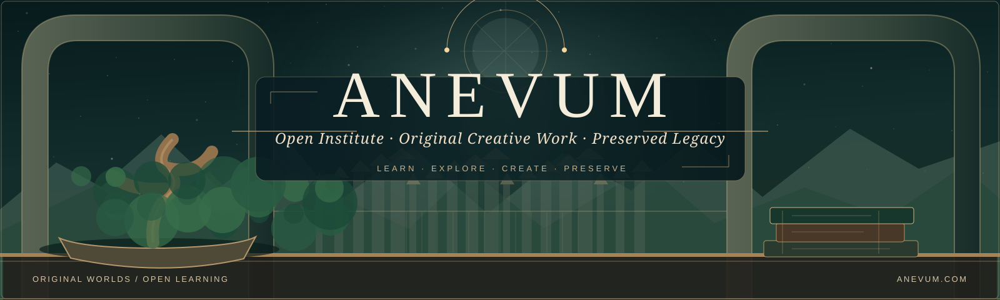
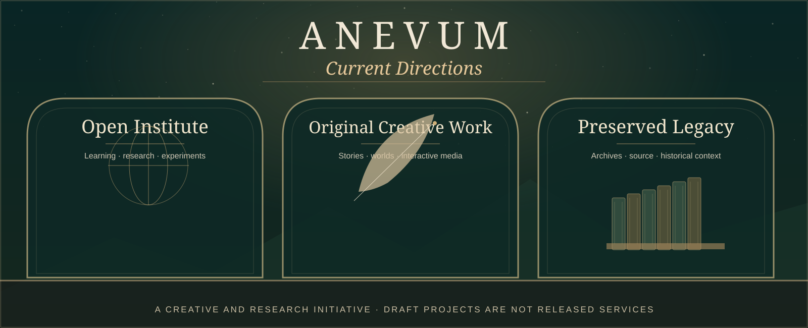

<p align="center"></p>

# Anevum — Web

> **Public documentation note · November 19, 2026:** This repository contains a legacy integrated website plus isolated, unmerged design and research proposals. The original site, protected previews and production `anevum.com` are distinct. Source code and draft PRs do not prove that a public service, institution or organization has launched.

[Public website](https://anevum.com) · [Ongoing development](https://github.com/devonalanakins/anevum-web/pulls)

ANEVUM's public web source, educational research previews, creative archives and historically protected Command interface.

ANEVUM is an independent creative and research initiative led by Devon Alan Akins. Its emerging direction combines open technical learning, carefully documented experiments, nature and bonsai journals, original writing and creative experiences. The long-term public-interest mission is **a direction, not a statement of nonprofit incorporation, academic accreditation or formal institutional status**.

## Current development tracks

<p align="center"></p>

| Track | Review source | Status / limits |
| --- | --- | --- |
| **Open Institute** | [Draft PR #816](https://github.com/devonalanakins/anevum-web/pull/816) | Protected owner-review prototype of an independent, non-accredited learning environment. Introductory computer-systems lessons, educational simulators and a browser-local Research Desk are in review; no academic credit, certified research or public launch. |
| **Bonsai Living Atlas** | [Draft PR #815](https://github.com/devonalanakins/anevum-web/pull/815) | Isolated editorial specimen archive and design review. Illustrative concepts are not authentic specimen photos; production release remains gated. |
| **Original writing and worlds** | [Public portfolio index](https://github.com/devonalanakins/anevum) | Creative history and original works are preserved; earlier concepts are not evidence of active public products. |
| **Legacy integrated web / Command** | This repository's default branch | Earlier architecture retained for traceability. Do not assume its documented routes or financial research are the current ANEVUM mission. |

The repository contains multiple generations of work, with independent branches and release boundaries. See individual PRs for exact implementation and test evidence; neither protected preview has authorization to replace the public homepage.

## Open source

The code and documentation in this repository are licensed under the [Apache License 2.0](LICENSE). ANEVUM names, subsystem names, logos, marks, icons, and product branding are not licensed as trademarks. Security-sensitive findings should be reported privately rather than opened as public issues.

This repository is intentionally the public web surface. Private credentials, broker secrets, authenticated operator data, and non-public execution state do not belong here.

## Legacy integrated route architecture (source-level; verify live release separately)

- `/` — legacy integrated homepage source
- `/products` — canonical public product registry
- `/feed` — releases, Field Notes, public-safe runtime events, and research decisions
- `/field-notes` — public build / research journal
- `/about` — ANEVUM and founder context
- `/resume` — professional résumé
- `/products/rhen` — RHEN product hub
- `/products/rhen/evidence` — RHEN public-safe evidence
- `/products/rhen/architecture` — RHEN architecture and authority boundaries
- `/products/rhen/releases` — RHEN release history
- `/command` — protected operator surface
- `/command/public` — operator view of the public projection / truth boundary

The legacy source defines redirects for earlier `/live`, `/research`, `/architecture` and `/releases` URLs. The deployed routing and actual owners must be checked separately.

RHEN is a separate financial systems research project, with its own repository and operational boundaries; it is not the primary identity of Anevum's creative studio. IREN, GRAEN, VELUM and NOSTRA are internal RHEN research responsibilities, not standalone public creative-studio products.

## Historical financial-system evidence boundary

The older integrated RHEN financial-research source used the `PUBLIC-PERFORMANCE-v1` public projection contract. Historical public-safe views were limited to sanitized runtime state, aggregate percentage performance/drawdown, activity, research methodology and release evidence. This is not an active ANEVUM Open Institute feature or an investment-performance claim.

Public views must **not** expose:

- raw account equity, cash, buying power, deposits, or withdrawals
- open positions or orders
- traded symbols, prices, quantities, or fills
- individual trade history or dollar P&L
- exact entry/exit rules
- quality scores, thresholds, risk limits, or reproducible strategy parameters
- broker credentials, tokens, or private database records

Live results remain separate from replay, backtest, development, and research evidence. CI continues to enforce the public/private data contract.

## Operator — `/command`

The legacy code includes a protected Command interface for operator telemetry and controls. Its source-level security design uses Cloudflare Access assertions and Worker checks; these are **not proof of the current production configuration or of a newly approved Institute/Atlas operator service**.

Existing Command routes and public/private projection contracts must remain isolated during any future public-site transition.

## Stack

- React 19 + TypeScript
- Vite
- Cloudflare Workers / static assets
- Cloudflare Access for Command identity
- RHEN compute and deployment are independently owned; older integration notes do not establish the current hosting provider
- GitHub Actions verification; release ownership is documented separately

## Commands

```bash
npm install
npm run check
npm run build
npm run dev
```

## Deployment

The legacy `.github/workflows/deploy-production.yml` deliberately refuses to deploy. Do not re-enable it or assume a merge to `main` releases the current ANEVUM website. Verify the actual production source, Worker routing, bindings and rollback procedure before any release. Independent applications retain their existing deployment ownership until explicitly transferred.

Pull requests targeting `main` run `.github/workflows/anevum-verify.yml`; consult the exact run for its results and any scoped preview or browser checks. A passing check does not by itself authorize a production release.
